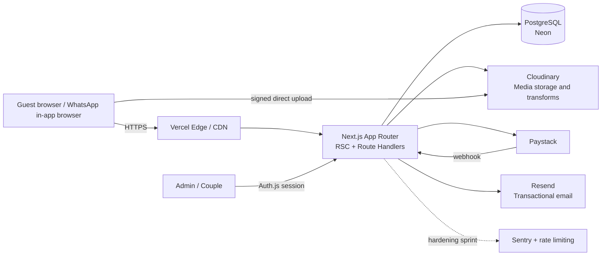
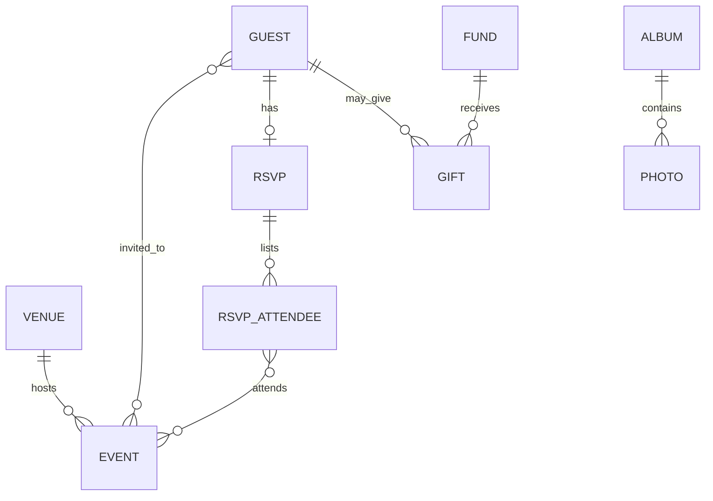
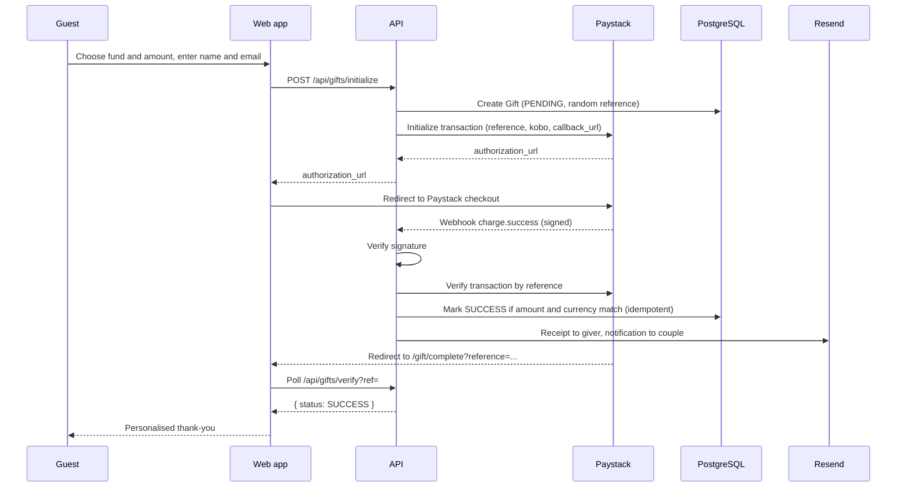
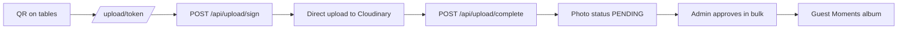
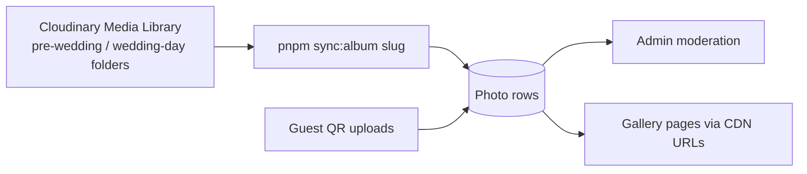
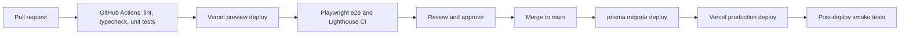

# Wedding Website: Architecture & Delivery Document (v2.1)

**Couple:** Adetolani Esther & Abiodun Emmanuel (monogram **AE**)
**Hashtag:** `#designedToBi'26`
**Wedding:** Saturday 19 December 2026 · Methodist Church, Olorunsogo-GeriAlimi, Ilorin, Kwara State
**Colour of the day:** White · Gold · Magenta
**Status:** v2.1, ready for development (Sprint 0 can start immediately)

---

## Table of Contents

0. [Decision Log and Changes Since v1](#0-decision-log-and-changes-since-v1)
1. [Vision and Success Criteria](#1-vision-and-success-criteria)
2. [Requirements](#2-requirements)
3. [Design System and Brand](#3-design-system-and-brand)
4. [System Architecture](#4-system-architecture)
5. [Tech Stack](#5-tech-stack)
6. [Repository Structure](#6-repository-structure)
7. [Data Model](#7-data-model)
8. [Routes and API Surface](#8-routes-and-api-surface)
9. [Core Flows](#9-core-flows)
10. [Frontend Architecture](#10-frontend-architecture)
11. [Gallery and Guest Uploads](#11-gallery-and-guest-uploads)
12. [Admin Dashboard (MVP)](#12-admin-dashboard-mvp)
13. [Security and Privacy](#13-security-and-privacy)
14. [Infrastructure, Environments and CI/CD](#14-infrastructure-environments-and-cicd)
15. [Testing Strategy](#15-testing-strategy)
16. [Observability](#16-observability)
17. [Delivery Roadmap (dated)](#17-delivery-roadmap-dated)
18. [Getting Started: Sprint 0](#18-getting-started-sprint-0)
19. [Launch Checklist and Runbooks](#19-launch-checklist-and-runbooks)
20. [Risks and Open Questions](#20-risks-and-open-questions)
21. [Appendix](#21-appendix)

---

## 0. Decision Log and Changes Since v1

### v2.1 amendments (5 Oct 2026)

Twenty amendments (A1–A20) found during implementation planning. Each is **applied inline** in the
sections below; the full rationale lives in [`plan/README.md §3`](plan/README.md).

| ID  | Amendment                                                                                                                                                                                                           | Applied in  |
| --- | ------------------------------------------------------------------------------------------------------------------------------------------------------------------------------------------------------------------- | ----------- |
| A1  | `GET /api/session/guest` resolves the signed cookie so `/` can stay static while greeting and RSVP pre-fill hydrate client-side                                                                                     | §8.2        |
| A2  | `GET /api/events/[slug]/ics` — the route required by §21.5                                                                                                                                                          | §8.2        |
| A3  | `/api/upload/sign` generates `public_id` server-side; `/api/upload/complete` verifies the asset exists in Cloudinary and reads `width`/`height` from it; both are gated on the open/closed upload window (no token) | §8.2, §9.6  |
| A4  | Map implemented as a designed `MapCard` poster + OpenStreetMap embed on tap (no Google Static Maps key); Bolt deep link only if the device test passes                                                              | §10.1       |
| A5  | Dependency list completed (`nanoid`, `next-auth` + adapter, `csv-parse`, `qrcode.react`, `browser-image-compression`, axe/LHCI, husky/lint-staged/commitlint)                                                       | §5          |
| A6  | Auth.js pinned: v5, Prisma adapter, custom Resend `sendVerificationRequest`, JWT session, allow-list enforced in `signIn` **and** `requireAdmin()`                                                                  | §5, §13.1   |
| A7  | All operational reads tagged `site`; mutations call `revalidateSite(paths)` = `revalidateTag` + `revalidatePath`                                                                                                    | §9.7, §4.2  |
| A8  | Source-of-truth rule: `site.config.ts` seeds the DB; the DB wins at runtime for operational data                                                                                                                    | §7.3        |
| A9  | `/gift/complete` polling state machine with backoff, timeout and honest terminal states                                                                                                                             | §9.4        |
| A10 | Scaffold at the repository root alongside `docs/`, not in a nested folder                                                                                                                                           | §6, §18     |
| A11 | `/privacy` route and `app/robots.ts` (noindex) added                                                                                                                                                                | §8.1, §10.5 |
| A12 | Local Postgres via `docker-compose.yml` (`wedding_dev`, `wedding_test`); CI service container                                                                                                                       | §14.1       |
| A13 | Vercel build runs `prisma migrate deploy && prisma generate && prisma db seed && next build`; local uses `migrate dev`                                                                                              | §14.3       |
| A14 | `NOTIFY_EMAIL` added for gift receipts and webhook alerts                                                                                                                                                           | §14.2       |
| A15 | `lib/env.ts` Zod schema + `.env.example` parity test in CI                                                                                                                                                          | §14.2       |
| A16 | `admin-guard-coverage.test.ts` fails CI if any `app/api/admin/**/route.ts` lacks `requireAdmin()`                                                                                                                   | §13.1       |
| A17 | `inviteMessage` template added to `SITE` for the admin copy action — **removed** with invite codes (see A21)                                                                                                        | §21.1, §12  |
| A18 | `Guest.side` surfaced as an admin filter in Sprint 3, or removed                                                                                                                                                    | §7.2        |
| A19 | `POST /api/gifts/declare`, admin collection endpoints and `/gallery/[slug]` added to the API surface                                                                                                                | §8.1, §8.2  |
| A20 | `seed:guests` supports `--export` for the final headcount export                                                                                                                                                    | §12         |
| A21 | Invite codes removed: `/rsvp` is open to everyone; signed guest session cookie (guest id) enables revisit/edit; per-IP throttle + honeypot for anti-abuse                                                           | §4.2, §9.1  |

### Decisions

| #   | Decision                                                                        | Notes                                                                                                                             |
| --- | ------------------------------------------------------------------------------- | --------------------------------------------------------------------------------------------------------------------------------- |
| D1  | **Two events, one venue.** Solemnization (11:00) and Reception (same venue)     | Reception start time is TBC; rendered as "Time to be announced" until set                                                         |
| D2  | **Paystack only.** Stripe removed everywhere                                    | Confirm international-card / USD support on the Paystack account                                                                  |
| D3  | **Gallery and guest uploads stay in v1**                                        | Pre-wedding, wedding-day and guest albums; QR uploads with manual moderation                                                      |
| D4  | **Public guest wall dropped for v1**                                            | The RSVP "message to the couple" is private to the couple. Wall is backlog                                                        |
| D5  | **RSVP is per person, per event**                                               | Fixes the household meal/dietary limitation in v1                                                                                 |
| D6  | **Placeholder logo behind a "logo contract"**                                   | Real logo is dropped in during development with a file swap and one config edit (see §3.4)                                        |
| D7  | **One generic OG card**, no per-guest OG images                                 | Personalisation happens on the page                                                                                               |
| D8  | **Framer Motion only** (no GSAP at launch)                                      | Revisit only if the timeline genuinely needs pinning that CSS sticky cannot do                                                    |
| D9  | **Minimal admin**; funds, bank accounts, events and milestones are seed-managed | See §12                                                                                                                           |
| D10 | **Phone/WhatsApp RSVP path is a requirement**                                   | Two RSVP contacts are printed on the invitation; admin supports manual RSVP entry                                                 |
| D11 | **Launch vendor set: Vercel, Neon, Cloudinary, Resend, Paystack**               | Sentry and rate limiting added in the hardening sprint; Turnstile only if spam appears                                            |
| D12 | **Security fixes from review applied**                                          | Webhook signature guard, verify endpoint hardening, redacted webhook payloads, bootstrap for settings, join table for invitations |

---

## 1. Vision and Success Criteria

### 1.1 Vision

A **gold-foil stationery suite brought to life**. The site should feel like receiving a hand-delivered, high-end invitation: cinematic, personal and effortless, while quietly doing serious work behind the scenes (RSVPs, payments, media, guest management). The printed invitation (burgundy-magenta circles, gold-foil lettering, floral corners, the AE monogram) is the art-direction anchor.

### 1.2 Success criteria

| Goal                    | Measure                                                                     |
| ----------------------- | --------------------------------------------------------------------------- |
| Looks and feels premium | Couple and close family sign off at the design review without major rework  |
| Guests can act easily   | ≥ 80% of invited households respond (web or phone) before the RSVP deadline |
| Gifting works           | Payment success ≥ 95% of initiated payments; zero unreconciled transactions |
| Fast on real phones     | LCP < 2.5s on a mid-range Android over 4G; CLS < 0.05                       |
| Reliable on the day     | No downtime in the event window; admin usable from a phone                  |
| Memories preserved      | Wedding-day gallery published within the agreed post-wedding window         |

### 1.3 Non-goals (v1)

- Public guest wall / comments feed
- Seating-chart tooling
- Multi-couple platform
- Native mobile app
- Guest video uploads (images only in v1)

---

## 2. Requirements

### 2.1 Functional

| ID  | Feature                        | Summary                                                                                                                          |
| --- | ------------------------------ | -------------------------------------------------------------------------------------------------------------------------------- |
| F1  | Invitation hero                | Names, date, countdown, monogram reveal, opening "envelope" sequence                                                             |
| F2  | Open RSVP                      | `/rsvp` is open to everyone; a signed session cookie lets guests revisit and edit; party size capped by `SITE.rsvp.maxPartySize` |
| F3  | Our Story timeline             | Scroll-driven milestones with photos and captions                                                                                |
| F4  | Events                         | Solemnization and Reception with date, time (or TBC), dress code, add-to-calendar                                                |
| F5  | Venue and directions           | Map, deep links (Google Maps, Waze, Uber, Bolt), landmarks, travel and accommodation notes for out-of-town guests                |
| F6  | Gallery                        | Albums: Pre-wedding, Wedding Day, Guest Moments. Lightbox, download, locked states                                               |
| F7  | Guest uploads                  | QR → /upload → moderated into "Guest Moments"                                                                                    |
| F8  | RSVP                           | Per person, per event; meal and dietary per person; private message to couple                                                    |
| F9  | Phone/WhatsApp RSVP path       | RSVP contacts with `wa.me` buttons; admin manual entry                                                                           |
| F10 | Gifting and donations          | Bank details with copy, Paystack payments, funds, receipts                                                                       |
| F11 | Dress code / colour of the day | White, Gold, Magenta swatches and guidance                                                                                       |
| F12 | FAQ and details                | Accommodation, contacts, live stream, hashtag                                                                                    |
| F13 | Admin (MVP)                    | RSVPs, guests, gifts, moderation, mode toggle (see §12)                                                                          |
| F14 | Site modes                     | `PRE` (invite), `LIVE` (event day), `POST` (thank-you and full gallery)                                                          |

### 2.2 Non-functional

- **Performance:** initial route JS ≤ ~180 KB gzipped; AVIF/WebP images; video posters.
- **Mobile-first:** design at 390px first. Many guests will open links inside WhatsApp's in-app browser, so avoid popups and rely on redirects.
- **Accessibility:** WCAG 2.1 AA targets; `prefers-reduced-motion` honoured; keyboard navigation; visible focus.
- **Time zone:** store UTC; render with `Africa/Lagos` (WAT, UTC+1) regardless of the viewer's location.
- **Availability:** serverless hosting with CDN; graceful degradation if payments or animations fail.
- **Privacy:** NDPA 2023 alignment; site is `noindex`.

---

## 3. Design System and Brand

### 3.1 Colour tokens

Magenta is an accent, never a wash. Gold is a metallic, never flat yellow.

| Token           | Value                                                    | Use                                                                                                        |
| --------------- | -------------------------------------------------------- | ---------------------------------------------------------------------------------------------------------- |
| `--ivory`       | `#FBF8F3`                                                | Primary canvas (~70%)                                                                                      |
| `--white`       | `#FFFFFF`                                                | Cards, form fields                                                                                         |
| `--gold-500`    | `#C9A24B`                                                | Rules, icons, borders                                                                                      |
| `--gold-grad`   | `linear-gradient(135deg, #B8892F, #E8CB7A 50%, #B8892F)` | Display accents, hairlines                                                                                 |
| `--magenta-600` | `#A3125F`                                                | CTAs, key dates, selected states (**TODO: sample the exact magenta from the invitation file and replace**) |
| `--magenta-800` | `#7A0C47`                                                | Hover/pressed                                                                                              |
| `--ink-900`     | `#2A0A1F`                                                | Dark sections, body text                                                                                   |
| `--ink-600`     | `#5B4553`                                                | Secondary text                                                                                             |

> **Contrast:** gold on ivory fails AA for body text. Use gold only for decorative elements and large display type.

### 3.2 Typography

| Role      | Font                                                                                                      |
| --------- | --------------------------------------------------------------------------------------------------------- |
| Display   | Cormorant Garamond or Fraunces (heavy, high-contrast serif, similar in feel to the invitation's headings) |
| Body/UI   | Jost or Inter                                                                                             |
| Signature | Script face for sign-offs only                                                                            |

Self-host via `next/font`, subset to Latin.

### 3.3 Motifs and motion principles

- Gold hairline dividers, subtle paper grain, dark aubergine-ink "night" sections where gold glows.
- Floral corner art from the invitation (once supplied as transparent PNG/SVG) as decorative overlays.
- Motion explains or delights, never blocks. Everything skippable. The opening sequence plays once per session.
- `prefers-reduced-motion`: replace parallax and scrubbing with simple fades.
- Animate `transform` and `opacity` only.

### 3.4 Logo contract (placeholder now, real logo later)

The logo is referenced from **one place only**, so swapping it in is a file replacement plus one config edit.

**Files**

```
public/brand/
  logo-placeholder.svg      # shipped now
  logo.svg | logo.png       # real logo, added during development
```

**Config (`content/site.config.ts`)**

```ts
brand: {
  logo: { src: "/brand/logo-placeholder.svg", kind: "svg", width: 240, height: 240 },
}
// Later: { src: "/brand/logo.png", kind: "png", width: 1600, height: 1600 }
```

**Component:** `components/brand/Logo.tsx` is the only file that reads `brand.logo`. It renders a plain `` (not `next/image`, which blocks SVG by default) and accepts `size` and `variant` props.

**Asset requirements for the real logo**

- SVG preferred; otherwise PNG with a transparent background, ≥ 1600px on the long side.
- Provide a gold version, and an ivory/white version for dark sections if available.
- Square or near-square artboard with even padding.

**Animation rule:** the logo reveal uses `opacity`, `scale` and a gold shimmer mask sweep, which work for **any** format (including a raster PNG). Do not rely on SVG path stroke-drawing. If the real logo is a clean SVG, a draw-on effect can be added later behind a `drawOn` flag.

**Dependents (all read from the config, none hardcode the logo):** hero, footer, favicon (`app/icon.png`, regenerated when the real logo lands), OG card, email templates.

**Placeholder SVG (`public/brand/logo-placeholder.svg`)**

```svg
<svg xmlns="http://www.w3.org/2000/svg" viewBox="0 0 240 240" role="img" aria-label="A and E monogram">
  <defs>
    <linearGradient id="g" x1="0" y1="0" x2="1" y2="1">
      <stop offset="0" stop-color="#B8892F"/>
      <stop offset=".5" stop-color="#E8CB7A"/>
      <stop offset="1" stop-color="#B8892F"/>
    </linearGradient>
  </defs>
  <circle cx="120" cy="120" r="112" fill="none" stroke="url(#g)" stroke-width="3"/>
  <circle cx="120" cy="120" r="102" fill="none" stroke="url(#g)" stroke-width="1"/>
  <text x="120" y="142" text-anchor="middle"
        font-family="Cormorant Garamond, Georgia, serif"
        font-size="84" font-weight="600" fill="url(#g)">AE</text>
</svg>
```

### 3.5 Component inventory

`Logo`, `Button`, `GoldRule`, `SectionHeading`, `EventCard`, `TimelineItem`, `GalleryGrid`, `Lightbox`, `AlbumLockedCard`, `RsvpStepper`, `AttendeeRow`, `GiftTabs`, `CopyField`, `FundCard`, `Countdown`, `MapCard`, `SwatchRow`, `UploadDropzone`, `Modal`, `Toast`.

---

## 4. System Architecture

### 4.1 High-level diagram



### 4.2 Architectural decisions

| #      | Decision                                                                       | Rationale                                                                                                                                                             |
| ------ | ------------------------------------------------------------------------------ | --------------------------------------------------------------------------------------------------------------------------------------------------------------------- |
| ADR-1  | Single Next.js app, no separate API service                                    | Small domain; route handlers suffice; one deploy                                                                                                                      |
| ADR-2  | PostgreSQL + Prisma                                                            | Relational integrity for guests, RSVPs, payments                                                                                                                      |
| ADR-3  | Cloudinary for media; `Photo` table kept for moderation state and ordering     | Guest uploads need PENDING/APPROVED state, so the DB stays the source of truth for what is visible                                                                    |
| ADR-4  | Paystack with redirect checkout; webhook is the source of truth                | No card data on our servers; WhatsApp in-app browsers handle redirects better than popups                                                                             |
| ADR-5  | Site mode in DB, cached with tag revalidation                                  | One toggle flips PRE → LIVE → POST without redeploy. **A7:** reads are tagged `site` via `lib/cache.ts` and mutations call `revalidateSite(paths)` (tag **and** path) |
| ADR-6  | Open RSVP at `/rsvp` with a signed guest session cookie, no invite codes (A21) | Zero friction; anti-abuse via honeypot + per-IP throttle; session cookie carries the guest id                                                                         |
| ADR-7  | Money as integer minor units (kobo)                                            | No float errors                                                                                                                                                       |
| ADR-8  | Static/ISR for public content; dynamic only where needed                       | Speed and resilience                                                                                                                                                  |
| ADR-9  | Logo behind a single config and component                                      | Real logo can land mid-development without rework                                                                                                                     |
| ADR-10 | Framer Motion only                                                             | One animation model, smaller bundle                                                                                                                                   |

### 4.3 Rendering strategy

| Route            | Strategy                                          |
| ---------------- | ------------------------------------------------- |
| `/`              | Static + ISR, revalidated by tag on admin changes |
| `/gallery`       | ISR + client pagination                           |
| `/rsvp`, `/gift` | Static shell + client forms                       |
| `/gift/complete` | Dynamic (reads gift status)                       |
| `/upload`        | Static (window-gated; tokenless)                  |
| `/admin/**`      | Dynamic, auth-protected                           |

---

## 5. Tech Stack

| Layer            | Choice                                                                                                                                 | Notes                                                                                                                                                                                                           |
| ---------------- | -------------------------------------------------------------------------------------------------------------------------------------- | --------------------------------------------------------------------------------------------------------------------------------------------------------------------------------------------------------------- |
| Framework        | Next.js (App Router) + TypeScript                                                                                                      | RSC + route handlers                                                                                                                                                                                            |
| Styling          | Tailwind CSS + CSS variables                                                                                                           | Tokens in `:root`; dark sections via data attributes                                                                                                                                                            |
| Motion           | Framer Motion                                                                                                                          | `useScroll` for timeline; CSS `position: sticky` for pinned scenes                                                                                                                                              |
| Forms/validation | React Hook Form + Zod                                                                                                                  | Shared schemas client and server                                                                                                                                                                                |
| DB / ORM         | PostgreSQL on Neon + Prisma                                                                                                            | Pooled URL for runtime, direct URL for migrations                                                                                                                                                               |
| Auth (admin)     | Auth.js (v5 or current stable) + Prisma adapter                                                                                        | Magic link via a custom `sendVerificationRequest` that sends through Resend; JWT sessions (link 30 min, session 8 h); allow-list checked in the `signIn` callback **and** again in `requireAdmin()` (A6, §13.1) |
| Media            | Cloudinary                                                                                                                             | Signed uploads, `f_auto,q_auto`, archive/zip API                                                                                                                                                                |
| Payments         | Paystack                                                                                                                               | Initialize + verify + webhook                                                                                                                                                                                   |
| Email            | Resend + React Email                                                                                                                   | Confirmations, receipts                                                                                                                                                                                         |
| Supporting libs  | `nanoid` (test id fixtures), `csv-parse` (`seed:guests`), `qrcode.react` (upload QR), `browser-image-compression` (client-side resize) | A5 — required by §11.2, §9.6, §12                                                                                                                                                                               |
| Tooling          | Husky + lint-staged + commitlint (Conventional Commits), Prettier                                                                      | A5 — standard git practice; enforced in CI                                                                                                                                                                      |
| Hardening sprint | Sentry; rate limiting (Vercel Firewall rules where the plan allows, otherwise Upstash)                                                 | Not needed on day 1                                                                                                                                                                                             |
| Conditional      | Turnstile                                                                                                                              | Only if spam appears                                                                                                                                                                                            |
| Testing          | Vitest, Playwright, `@axe-core/playwright`, Lighthouse CI                                                                              |                                                                                                                                                                                                                 |

**Not used:** Stripe, GSAP, Upstash (until hardening), Turnstile (unless needed).

> **A5 — dependency policy:** add a dependency only when a task requires it, justify it in the PR
> description, and never install globally. No UI kits, no state libraries, no date libraries
> (`Intl` + `lib/datetime.ts` cover this project).

---

## 6. Repository Structure

**A10:** the app is scaffolded at the **repository root**, alongside `docs/` — there is no nested
project folder. The working directory `wedding-invite/` is the repo root.

```
wedding-invite/                  # repo root (A10)
├─ docs/
│  ├─ architecture.md            # this document (v2.1)
│  └─ plan/                      # implementation plan, gates and STATUS.md
├─ app/
│  ├─ layout.tsx  globals.css  robots.ts  opengraph-image.tsx  icon.png  not-found.tsx
│  ├─ (public)/
│  │  ├─ page.tsx                  # Home: hero, story, events, venue, dress code, FAQ
│  │  ├─ gallery/page.tsx
│  │  ├─ gallery/[slug]/page.tsx   # Album detail (A19)
│  │  ├─ gift/page.tsx
│  │  ├─ gift/complete/page.tsx
│  │  ├─ rsvp/page.tsx
│  │  ├─ thank-you/page.tsx
│  │  ├─ privacy/page.tsx          # NDPA notice (A11)
│  ├─ upload/page.tsx
│  └─ upload/[token]/page.tsx (redirect stub → /upload)
│  ├─ admin/
│  │  ├─ layout.tsx                # Auth gate
│  │  ├─ page.tsx  guests/  rsvps/  gifts/  media/  settings/
│  ├─ api/
│  │  ├─ auth/[...nextauth]/route.ts
│  │  ├─ session/guest/route.ts    # A1: cookie → guest payload
│  │  ├─ rsvp/route.ts
│  │  ├─ events/[slug]/ics/route.ts# A2
│  │  ├─ gifts/initialize/route.ts
│  │  ├─ gifts/declare/route.ts    # A19
│  │  ├─ gifts/verify/route.ts
│  │  ├─ webhooks/paystack/route.ts
│  │  ├─ upload/sign/route.ts
│  │  ├─ upload/complete/route.ts
│  │  ├─ health/route.ts
│  │  └─ admin/**                  # Protected mutations; each calls requireAdmin()
├─ components/
│  ├─ brand/Logo.tsx
│  ├─ ui/  sections/  motion/
├─ lib/
│  ├─ env.ts  db.ts  auth.ts  admin.ts  cache.ts  settings.ts
│  ├─ cloudinary.ts  paystack.ts  api.ts  codes.ts
│  ├─ email/  validation/  money.ts  datetime.ts  ics.ts  csv.ts  mode.ts  guest-cookie.ts
├─ prisma/
│  ├─ schema.prisma
│  └─ seed.ts                      # Settings row, venue, events, funds, bank accounts, milestones, albums
├─ scripts/
│  ├─ seed-guests.ts               # pnpm seed:guests guests.csv [--export]  (A20)
│  ├─ sync-album.ts                # pnpm sync:album <slug>  (Cloudinary folder → Photo rows)
│  ├─ zip-album.ts                 # pnpm zip:album <slug>
│  ├─ reconcile-gifts.ts           # pnpm gifts:reconcile
│  ├─ check-bundle.mjs             # pnpm check:bundle  (180 KB budget)
│  └─ security-scan.mjs            # pnpm security:scan (headers + noindex)
├─ content/site.config.ts
├─ public/brand/  public/fonts/
├─ tests/  (unit/  integration/  e2e/  factories.ts  load/)
├─ docker-compose.yml              # wedding_dev + wedding_test (A12)
├─ .env.example                    # every key, parity-tested (A15)
├─ .github/workflows/ci.yml  pull_request_template.md
└─ README.md  RUNBOOK.md
```

---

## 7. Data Model

### 7.1 ER overview



### 7.2 Prisma schema

```prisma
generator client { provider = "prisma-client-js" }
datasource db { provider = "postgresql"; url = env("DATABASE_URL"); directUrl = env("DIRECT_URL") }

enum SiteMode   { PRE LIVE POST }          // order matters: PRE < LIVE < POST
enum RsvpStatus { PENDING ATTENDING DECLINED }
enum RsvpSource { WEB PHONE WHATSAPP }
enum GiftStatus { PENDING SUCCESS FAILED ABANDONED }
enum GiftChannel { PAYSTACK BANK_TRANSFER_DECLARED }
enum MediaStatus { PENDING APPROVED REJECTED }
enum MediaSource { ADMIN GUEST }
enum Side { PARTNER_A PARTNER_B BOTH }

model Guest {
  id           String   @id @default(cuid())
  displayName  String                         // "The Adeyemi Family"
  email        String?
  phone        String?
  side         Side     @default(BOTH)          // A18: shown as an admin filter in Sprint 3, or dropped
  maxPartySize Int      @default(1)
  ipHash       String?                         // HMAC of client IP; per-IP throttle (A21)
  createdAt    DateTime @default(now())
  @@index([ipHash])
  invitations  Invitation[]
  rsvp         Rsvp?
  gifts        Gift[]
}

model Venue {
  id      String  @id @default(cuid())
  name    String
  address String
  city    String
  lat     Float?                                // TODO: exact pin from the couple
  lng     Float?
  notes   String?                                // landmarks, parking, access
  events  Event[]
}

model Event {
  id          String   @id @default(cuid())
  slug        String   @unique                   // "solemnization", "reception"
  title       String
  startsAt    DateTime                            // UTC
  timeTbc     Boolean  @default(false)           // show "Time to be announced"
  endsAt      DateTime?
  dressCode   String?
  notes       String?
  sortOrder   Int      @default(0)
  venueId     String
  venue       Venue    @relation(fields: [venueId], references: [id])
  invitations Invitation[]
  attendees   AttendeeEvent[]
}

model Invitation {                               // which guest is invited to which event
  guestId String
  eventId String
  guest   Guest @relation(fields: [guestId], references: [id], onDelete: Cascade)
  event   Event @relation(fields: [eventId], references: [id])
  @@id([guestId, eventId])
}

model Rsvp {                                     // one household response
  id          String     @id @default(cuid())
  guestId     String     @unique
  status      RsvpStatus @default(PENDING)
  source      RsvpSource @default(WEB)
  message     String?                             // private to the couple
  respondedAt DateTime?
  updatedAt   DateTime   @updatedAt
  guest       Guest      @relation(fields: [guestId], references: [id], onDelete: Cascade)
  attendees   RsvpAttendee[]
}

model RsvpAttendee {                             // one row per person
  id      String  @id @default(cuid())
  rsvpId  String
  name    String
  meal    String?
  dietary String?
  rsvp    Rsvp    @relation(fields: [rsvpId], references: [id], onDelete: Cascade)
  events  AttendeeEvent[]
}

model AttendeeEvent {                            // presence = attending that event
  attendeeId String
  eventId    String
  attendee   RsvpAttendee @relation(fields: [attendeeId], references: [id], onDelete: Cascade)
  event      Event        @relation(fields: [eventId], references: [id])
  @@id([attendeeId, eventId])
}

model Fund {
  id           String  @id @default(cuid())
  slug         String  @unique                  // "honeymoon", "first-home", "donation"
  title        String
  description  String?
  goalMinor    Int?
  showProgress Boolean @default(false)
  isDonation   Boolean @default(false)
  sortOrder    Int     @default(0)
  isActive     Boolean @default(true)
  gifts        Gift[]
}

model Gift {
  id          String      @id @default(cuid())
  reference   String      @unique                // random 128-bit, our idempotency key
  providerRef String?     @unique                // Paystack transaction id
  guestId     String?
  fundId      String?
  channel     GiftChannel
  status      GiftStatus  @default(PENDING)
  amountMinor Int                                  // kobo
  currency    String      @default("NGN")
  giverName   String
  giverEmail  String?                              // required in code for PAYSTACK
  message     String?
  isAnonymous Boolean     @default(false)
  paidAt      DateTime?
  rawEvent    Json?                                // REDACTED subset only (see §13.2)
  createdAt   DateTime    @default(now())
  guest       Guest?      @relation(fields: [guestId], references: [id])
  fund        Fund?       @relation(fields: [fundId], references: [id])
  @@index([status, createdAt])
}

model BankAccount {
  id            String  @id @default(cuid())
  label         String
  bankName      String
  accountName   String
  accountNumber String
  currency      String  @default("NGN")
  sortOrder     Int     @default(0)
  isActive      Boolean @default(true)
}

model Album {
  id          String   @id @default(cuid())
  slug        String   @unique                   // "pre-wedding" | "wedding-day" | "guest-moments"
  title       String
  visibleFrom SiteMode @default(PRE)             // album visible when mode >= visibleFrom
  photos      Photo[]
}

model Photo {
  id          String      @id @default(cuid())
  albumId     String
  publicId    String      @unique                 // Cloudinary public_id
  width       Int
  height      Int
  caption     String?
  altText     String?
  sortOrder   Int         @default(0)
  status      MediaStatus @default(APPROVED)      // guest uploads default to PENDING
  source      MediaSource @default(ADMIN)
  uploadedBy  String?                              // guest session id for guest uploads
  createdAt   DateTime    @default(now())
  album       Album       @relation(fields: [albumId], references: [id])
  @@index([albumId, status, sortOrder])
}

model Milestone {
  id            String @id @default(cuid())
  title         String
  dateLabel     String
  body          String
  photoPublicId String?
  sortOrder     Int
}

model Setting {                                  // singleton, always id = 1
  id              Int      @id @default(1)
  mode            SiteMode @default(PRE)
  rsvpDeadline    DateTime?
  uploadsOpen     Boolean  @default(false)
  uploadsCloseAt  DateTime?
  liveStreamUrl   String?
}

model AdminUser {
  id    String @id @default(cuid())
  email String @unique
  name  String?
}

model AuditLog {
  id        String   @id @default(cuid())
  actor     String
  action    String
  entity    String
  entityId  String?
  meta      Json?
  createdAt DateTime @default(now())
}
```

### 7.3 Data notes

- **A8 — source of truth:** `content/site.config.ts` owns brand, copy, contacts and static facts,
  and is the _input_ to `prisma/seed.ts`. The database owns operational state (mode, deadline,
  events, venue, funds, bank accounts, albums, milestones, guests, RSVPs, gifts, photos).
  `SITE.rsvp.deadline` seeds `Setting.rsvpDeadline`; **after seeding, the DB wins** — the runtime
  reads config only for brand/copy/contacts, and never for anything an admin can change. Editing
  config requires a redeploy; editing the DB does not.
- **Settings bootstrap:** Prisma does not auto-create the singleton. Use the helper below everywhere and also call it in `seed.ts`.
  ```ts
  // lib/settings.ts
  export const getSettings = () =>
    prisma.setting.upsert({ where: { id: 1 }, update: {}, create: { id: 1 } });
  ```
  Wrap reads in a cached function tagged `site`.
- **Headcount per event** = `count(AttendeeEvent where eventId = X)`. **Household status** is `ATTENDING` when any attendee has at least one event, `DECLINED` when the household declines, `PENDING` before responding.
- **Album visibility:**
  ```ts
  // lib/mode.ts
  const ORDER = { PRE: 0, LIVE: 1, POST: 2 } as const;
  export const isAlbumVisible = (visibleFrom: keyof typeof ORDER, mode: keyof typeof ORDER) =>
    ORDER[mode] >= ORDER[visibleFrom];
  ```
  Seed: `pre-wedding` → `PRE`, `guest-moments` → `LIVE`, `wedding-day` → `POST`.
- **Reception time TBC:** seed a placeholder `startsAt` on the same date with `timeTbc = true`; UI shows "Time to be announced" and omits the time from the calendar file until set.
- Never store card data, secrets or full webhook payloads.

---

## 8. Routes and API Surface

### 8.1 Public pages

| Path                      | Purpose                                                                                                      |
| ------------------------- | ------------------------------------------------------------------------------------------------------------ |
| `/`                       | Hero, story, events, venue, dress code, FAQ                                                                  |
| `/rsvp`                   | Open RSVP form (no code required); a signed session cookie pre-fills and enables editing a previous response |
| `/gift`, `/gift/complete` | Gifting hub and post-payment status                                                                          |
| `/gallery`                | Albums; locked albums show a "Coming soon" card                                                              |
| `/gallery/[slug]`         | Album detail with client pagination; hidden albums 404 like unknown slugs (A19)                              |
| `/privacy`                | Short NDPA privacy notice linked from the footer, RSVP form and upload page (A11)                            |
| `/thank-you`              | Post-wedding message                                                                                         |
| `/upload`                 | Guest photo upload (window-gated, tokenless)                                                                 |

> Indexing is disabled site-wide: `app/robots.ts` returns `Disallow: /`, every page sets
> `robots: noindex, nofollow`, and an `X-Robots-Tag` header backs it up (A11, see §10.5).

### 8.2 API endpoints

| Method | Path                     | Auth                                          | Description                                                                                                                                                                                                                                                    |
| ------ | ------------------------ | --------------------------------------------- | -------------------------------------------------------------------------------------------------------------------------------------------------------------------------------------------------------------------------------------------------------------- |
| GET    | `/api/session/guest`     | guest cookie                                  | **A1.** Resolves the signed cookie into `{ displayName, maxPartySize, events, greeting, rsvp }`, or `{ guest: null }`. `cache: no-store`. Never returns the guest's email/phone. Lets `/` stay static while the greeting and RSVP pre-fill hydrate client-side |
| POST   | `/api/rsvp`              | none (guest session cookie issued on success) | Open endpoint (A21): throttle new guests per IP hash, create-or-update the guest (new guests are invited to every seeded event), replace attendees and per-event attendance in one transaction, set the signed `guest_session` cookie, send confirmation email |
| GET    | `/api/events/[slug]/ics` | none                                          | **A2.** Server-generated `.ics` (§21.5): `text/calendar; charset=utf-8` with `Content-Disposition: attachment`; all-day event when `timeTbc`; 404 for unknown slugs                                                                                            |
| POST   | `/api/gifts/initialize`  | none (rate-limited in hardening)              | Validate, create `Gift` (PENDING, random reference), call Paystack initialize, return `authorization_url`                                                                                                                                                      |
| POST   | `/api/gifts/declare`     | none (rate-limited in hardening)              | **A19.** "I've sent a transfer": creates `Gift{ channel: BANK_TRANSFER_DECLARED, status: PENDING }`. Never counts as paid until an admin marks it received (§9.5)                                                                                              |
| GET    | `/api/gifts/verify?ref=` | none                                          | **Returns `{ status }` only.** Reference is a random 128-bit value; rate-limited                                                                                                                                                                               |
| POST   | `/api/webhooks/paystack` | HMAC signature                                | Verify, update `Gift`, send receipt                                                                                                                                                                                                                            |
| POST   | `/api/upload/sign`       | upload token + window open                    | **A3.** Generates the Cloudinary `public_id` server-side and returns signed params (`public_id`, `folder`, `timestamp`, `max_file_size`, `allowed_formats`) bound to them                                                                                      |
| POST   | `/api/upload/complete`   | upload token                                  | **A3.** Verifies the asset exists via the Cloudinary Admin API, takes `width`/`height` from it, and records `Photo` as `PENDING` (idempotent: an existing row is returned). A `publicId` that was never uploaded returns 404 and writes nothing                |
| GET    | `/api/health`            | none                                          | Uptime check (DB ping)                                                                                                                                                                                                                                         |
| `*`    | `/api/admin/**`          | admin session                                 | Admin mutations: `GET/PATCH` for `guests`, `rsvps` (incl. manual entry + `export`), `gifts` (+ `export`), `media` (+ `bulk`), `settings` (+ `upload-token`), `overview` (A19). **Every handler calls `requireAdmin()` first** (A16, §13.1)                     |

### 8.3 RSVP payload

```ts
// lib/validation/rsvp.ts
export const RsvpInput = z.object({
  declined: z.boolean().default(false),
  attendees: z
    .array(
      z.object({
        name: z.string().trim().min(2).max(80),
        events: z.array(z.enum(['solemnization', 'reception'])).min(1),
        meal: z.string().max(60).optional(),
        dietary: z.string().max(200).optional(),
      }),
    )
    .max(10)
    .default([]),
  message: z.string().max(600).optional(),
});
```

Server rules: events must be within the guest's `Invitation` rows; attendee count ≤ `maxPartySize`; deadline not passed (admin may override); meal fields only if `rsvp.collectMeal` is on.

---

## 9. Core Flows

### 9.1 Open RSVP (A21)

1. Anyone can open `/rsvp` — no invitation code or lookup step.
2. The form asks for the responder's name (required) plus optional email and phone; the first
   attendee row auto-fills from the responder name while it is empty. Party size is capped at
   `SITE.rsvp.maxPartySize`.
3. On submit, `POST /api/rsvp` throttles new guests per IP hash, creates the guest (invited to
   every seeded event, so the event-gating rules stay unchanged) or updates the one bound to the
   session, saves the RSVP, and sets a signed `guest_session` cookie carrying the guest id.
4. Returning visitors get their previous response pre-filled and can edit it; "Start a different
   response" clears the form and starts a new guest.
5. Guest links for gifts and uploads resolve from the same session cookie.

### 9.2 RSVP (web)

```mermaid
sequenceDiagram
    participant G as Guest
    participant W as Web app
    participant A as API /rsvp
    participant DB as PostgreSQL
    participant E as Resend
    G->>W: Open /rsvp (returning guest: session cookie prefills)
    G->>W: Enter name (+ optional email/phone), add attendees, pick events and meals, submit
    W->>A: POST /api/rsvp (Zod-validated, honeypot checked)
    A->>DB: Load settings, events, guest from session
    A->>A: Check deadline, party size, invited events; per-IP throttle for new guests
    A->>DB: Transaction: create/update guest (+ invitations), replace attendees and AttendeeEvent rows, set status
    A-->>W: 200 + summary, guest_session cookie set
    A->>E: Confirmation email (if email known)
    A-->>W: 200 + summary
    W-->>G: Confirmation screen with add-to-calendar
```

### 9.3 RSVP (phone / WhatsApp)

- RSVP page and footer show the two RSVP contacts printed on the invitation, each with a `wa.me` button and a `tel:` link. Verify that both numbers are on WhatsApp before launch.
- Coordinators record responses in **Admin → RSVPs → Add/Edit for guest**, which uses the same payload and sets `source = PHONE | WHATSAPP`.

### 9.4 Gift via Paystack



**Rules**

- The **webhook is authoritative**. The redirect only triggers polling of our DB.
- **A9 — `/gift/complete` state machine:** `reading → polling (2s, 4s, 8s, 8s, 8s …) → SUCCESS |
FAILED | ABANDONED | STILL_PROCESSING`. Polling aborts on unmount and on a terminal state; after
  ~30s it settles on "we're confirming your payment — we'll email you a receipt" and stops.
  Success is never inferred from the redirect, an unknown reference renders a graceful state with
  the RSVP contacts, and all states work under `prefers-reduced-motion`.
- Paystack requires an **email** for every transaction, so the gift form requires one.
- Offer preset amounts (for example ₦5,000 / ₦10,000 / ₦20,000 / ₦50,000) plus a custom amount; the couple sets the minimum.
- Compare `amount` and `currency` from Paystack against our row before marking success. Ignore duplicates when status is already `SUCCESS`.
- Read the **raw body** for signature verification (`await req.text()`), persist, respond `200` quickly, do emails afterwards.
- `pnpm gifts:reconcile` verifies every `PENDING` gift older than 30 minutes against Paystack and updates its status (SUCCESS / FAILED / ABANDONED).
- Fees: decide whether the couple absorbs Paystack fees or the giver is offered a "cover the fee" option (open question).

### 9.5 Bank transfer display

- Active `BankAccount` rows render server-side with a **Copy** button per field.
- Account names are verified with the couple before launch.
- An optional "I've sent a gift" form records `BANK_TRANSFER_DECLARED` so the couple can say thank you; it never counts as paid until an admin marks it received.

### 9.6 Guest photo uploads



1. Admin sets `uploadsOpen = true` and an optional `uploadsCloseAt` (for example a week after the wedding); a rotating `uploadToken` is generated and shown as a QR.
2. `/upload/[token]` validates the token and window. The page shows a short privacy note and a dropzone (images only, multiple files, progress per file).
3. **A3:** the client requests signed params; `/api/upload/sign` generates the `public_id`
   (`wedding/guest-uploads/<yyyy>/<mm>/<random>`), and the signature is bound to that id, the
   folder, the allowed formats and the max size.
4. Browser uploads directly to Cloudinary. JPEG/PNG files over a threshold are compressed client-side; **HEIC from iPhones is uploaded as is and converted by Cloudinary**.
5. **A3:** `/api/upload/complete` verifies the asset exists through the Cloudinary Admin API,
   takes `width` and `height` from it, then creates the `Photo` row (`PENDING`, `source = GUEST`,
   `uploadedBy = guest session id ?? "guest"`). The call is idempotent; a `publicId` that was never
   uploaded returns 404 and writes nothing.
6. Approved photos appear in the **Guest Moments** album (visible from `LIVE`).

### 9.7 Site modes

| Mode   | Behaviour                                                                                                           |
| ------ | ------------------------------------------------------------------------------------------------------------------- |
| `PRE`  | "Join us"; RSVP and gifting open; pre-wedding album visible; other albums locked                                    |
| `LIVE` | Live-stream banner and "Today" card; uploads open; Guest Moments visible                                            |
| `POST` | "Thank you" hero; RSVP closed; Wedding Day album unlocked; highlights video; gifting stays open if the couple wants |

**A7 — revalidation:** every mode/content-dependent Prisma read goes through
`lib/cache.ts` (`unstable_cache(..., { tags: ["site"] })`), and every mutation calls
`revalidateSite(paths)`, which performs **both** `revalidateTag("site")` (refreshes the cached
reads) and `revalidatePath()` for each affected route (refreshes the rendered ISR HTML). Calling
only one of the two leaves the mode toggle apparently broken. Cached pages then update within
seconds — no redeploy.

---

## 10. Frontend Architecture

### 10.1 Home composition

1. Opening sequence (optional, once per session): envelope and wax seal, then hero.
2. Hero: logo reveal, names, date, countdown to **19 Dec 2026, 11:00 WAT**, RSVP and Directions buttons, hashtag.
3. Invitation text (families and wording taken **verbatim** from the printed invitation) with a personalised greeting when the cookie is present.
4. Our Story: scroll timeline, gold line connecting milestones.
5. Events: Solemnization and Reception cards; add-to-calendar.
6. Venue: **A4** — a designed `MapCard` poster (venue name, pin glyph, gold hairline frame) with
   deep links; tapping it lazy-loads an OpenStreetMap embed in a modal (no Google Static Maps key
   or billing). Deep links: Google Maps, Waze, Uber; Bolt only if the device test passes, otherwise
   it is dropped. With no pin yet, links fall back to a query search on venue + city and the modal
   shows written directions. Landmarks, travel and accommodation notes for out-of-town guests.
7. Colour of the day: swatches and guidance.
8. Gallery and gifts teasers.
9. FAQ, RSVP contacts, hashtag, footer.

### 10.2 Motion

- **Opening sequence and UI:** Framer Motion timelines; skipped when `prefers-reduced-motion` or the session flag is set.
- **Logo reveal:** opacity + scale + shimmer mask (format-agnostic, see §3.4).
- **Timeline:** `useScroll` + `useTransform` inside a CSS `position: sticky` container on desktop; simple reveal-on-scroll on mobile.
- **Guardrails:** animate `transform` and `opacity` only; unmount heavy scenes offscreen; no layout thrash.

### 10.3 Performance

| Technique  | Detail                                                                                          |
| ---------- | ----------------------------------------------------------------------------------------------- |
| Images     | Cloudinary `f_auto,q_auto`, responsive `srcset`, blur-up placeholder via a tiny transformed URL |
| Hero media | Poster first; video only on good connections and not on data-saver                              |
| Splitting  | Lightbox, map and upload dropzone loaded on demand                                              |
| Fonts      | Self-hosted, subset, hero font preloaded                                                        |
| Caching    | ISR + tag revalidation; immutable static assets                                                 |
| Budgets    | Lighthouse CI fails below mobile perf 90 or LCP > 2.5s                                          |

### 10.4 Accessibility

- Landmarks, skip link, labelled controls, error summaries.
- Every animation has a static equivalent.
- Gold decorative elements are `aria-hidden`; text colours meet contrast.
- Lightbox traps focus and supports Esc and arrow keys; alt text editable per photo.

### 10.5 Metadata and sharing

- **One** generic OG card (`app/opengraph-image.tsx`): logo, names, date, hashtag, palette. It builds from the brand config, so it updates when the real logo lands.
- **A11:** `app/robots.ts` returns `Disallow: /` for all agents; every page sets
  `robots: { index: false, follow: false }` and an `X-Robots-Tag: noindex, nofollow` header backs
  it up (verified by `scripts/security-scan.mjs` in CI).
- `robots: noindex, nofollow` plus an `X-Robots-Tag` header.
- Manifest and theme colour set to ivory.

---

## 11. Gallery and Guest Uploads

### 11.1 Albums

| Album           | Source                        | Visible from | Notes                                         |
| --------------- | ----------------------------- | ------------ | --------------------------------------------- |
| `pre-wedding`   | Admin (Cloudinary folder)     | `PRE`        | Available now                                 |
| `guest-moments` | Guest uploads (approved only) | `LIVE`       | Moderated                                     |
| `wedding-day`   | Photographer delivery         | `POST`       | Shows a "Coming soon" locked card before then |

### 11.2 Pipeline



- **Folders:** `wedding/pre-wedding`, `wedding/wedding-day`, `wedding/guest-uploads`, `wedding/story`.
- **Pro albums:** upload to Cloudinary through the Media Library, then run `pnpm sync:album <slug>` to create `Photo` rows (width, height, order by filename). No bulk-upload UI is built in v1.
- **Guest uploads:** manual moderation only (no paid moderation add-ons in v1).
- **Download:** `pnpm zip:album <slug>` generates a zip link for the couple. Individual photos can be downloaded from the lightbox.
- **Limits:** enforce a max file size and image-only formats in the upload preset. Check the Cloudinary plan's storage and bandwidth allowance against expected guest uploads before the wedding.

---

## 12. Admin Dashboard (MVP)

Mobile-friendly, protected by Auth.js with an allow-list of the couple's and developer's emails.

| Area     | Capabilities                                                                                                                 |
| -------- | ---------------------------------------------------------------------------------------------------------------------------- |
| Overview | RSVP counts per event, total headcount, meals, gift total, pending uploads                                                   |
| Guests   | List, search, add/edit one guest (manual/phone entry alongside guests created by the open RSVP form). Bulk import via script |
| RSVPs    | List, filter non-responders, **add/edit for a guest (phone or WhatsApp)**, CSV export                                        |
| Gifts    | Ledger by status and fund, mark bank transfer received, CSV export                                                           |
| Media    | Moderation queue with **bulk approve/reject**; edit alt text and caption                                                     |
| Settings | Mode toggle, RSVP deadline, upload window and QR regeneration, live-stream URL                                               |

**Managed by seed and Prisma Studio (no UI in v1):** funds, bank accounts, events, venue, milestones, albums.
**Scripts:** `seed:guests` (import `guests.csv`, `--dry-run`, idempotent; **A20:** `--export`
writes the guest list for the final headcount), `sync:album`, `zip:album`,
`gifts:reconcile`.

---

## 13. Security and Privacy

### 13.1 Threats and controls

| Area            | Risk                    | Control                                                                                                                                                                                                                                                                                                                                            |
| --------------- | ----------------------- | -------------------------------------------------------------------------------------------------------------------------------------------------------------------------------------------------------------------------------------------------------------------------------------------------------------------------------------------------- |
| RSVP throttle   | Spam guest creation     | Per-IP hash (`Guest.ipHash`, HMAC of client IP): max 10 new guests per 10-minute window → `429 RATE_LIMITED`; edits via a valid session cookie are never throttled (A21)                                                                                                                                                                           |
| Guest session   | Tampering or replay     | **The cookie is a signed guest-id token**, not a bearer secret: HMAC-signed and `HttpOnly`. It only enables pre-filling and editing that guest's own RSVP; party size, invited events and the deadline are always re-checked against the database                                                                                                  |
| Guest codes     | Guessing                | **Removed (A21).** `/rsvp` is open; anti-abuse is the honeypot + per-IP throttle above                                                                                                                                                                                                                                                             |
| Payments        | Spoofed success         | HMAC-verified webhook, server-side verify call, amount and currency matching, idempotent updates                                                                                                                                                                                                                                                   |
| Payments        | Signature handler crash | Length guard before `timingSafeEqual` (see §21.2)                                                                                                                                                                                                                                                                                                  |
| `/gifts/verify` | Data leak               | Returns status only; random 128-bit reference; rate-limited                                                                                                                                                                                                                                                                                        |
| Forms           | Spam                    | Honeypot, validation; rate limiting in hardening; Turnstile only if spam appears                                                                                                                                                                                                                                                                   |
| Uploads         | Malicious or huge files | Signed uploads with allowed formats and max size, `PENDING` by default, admin approval                                                                                                                                                                                                                                                             |
| Admin           | Unauthorised access     | Allow-listed emails, magic link, short sessions, audit log. **A6:** the allow-list is enforced in the `signIn` callback _and_ in `requireAdmin()`. **A16:** `tests/unit/admin-guard-coverage.test.ts` scans `app/api/admin/**/route.ts` and fails CI if any handler does not call `requireAdmin()` — a layout guard protects pages, not API routes |
| Secrets         | Leakage                 | Env vars only; separate keys per environment; server-only access                                                                                                                                                                                                                                                                                   |
| XSS             | User text               | Zod validation, output escaping, no raw HTML rendering                                                                                                                                                                                                                                                                                             |
| Headers         | Hardening               | CSP, HSTS, `X-Content-Type-Options`, `Referrer-Policy`, frame protection                                                                                                                                                                                                                                                                           |
| Bank details    | Tampering               | Editable only through the database/admin; changes audit-logged                                                                                                                                                                                                                                                                                     |

### 13.2 Privacy (NDPA 2023)

- Collect the minimum: name, optional email/phone, RSVP details, meals and dietary notes.
- Short privacy notice linked from the footer, RSVP form and upload page.
- Guests can request correction or deletion via the RSVP contacts.
- **`Gift.rawEvent` is redacted:** store only event type, reference, amount, currency, status and gateway IDs. Strip payer name, email and `authorization`/`customer` objects.
- **Retention:** after the agreed period (for example 90 days post-wedding) delete dietary notes, null `rawEvent`, and remove guest contact details, except payment records the couple needs to keep.
- Keep the site `noindex`; never publish guest lists.

---

## 14. Infrastructure, Environments and CI/CD

### 14.1 Environments

| Env        | Purpose            | Data                                                                                                                                                                               |
| ---------- | ------------------ | ---------------------------------------------------------------------------------------------------------------------------------------------------------------------------------- |
| Local      | Development        | **A12:** `docker-compose.yml` runs Postgres with two databases — `wedding_dev` and `wedding_test` (tests refuse to run unless the URL contains `wedding_test`); Paystack test keys |
| Preview    | Every PR on Vercel | Neon preview branch; test keys; seeded fake guests                                                                                                                                 |
| Production | Live site          | Production DB; live Paystack keys; real domain                                                                                                                                     |

**A12:** CI uses the same Postgres image as a service container so integration and e2e tests run
against `wedding_test` on every pull request.

### 14.2 Environment variables

```
DATABASE_URL=                   # pooled
DIRECT_URL=                     # migrations
NEXT_PUBLIC_SITE_URL=
AUTH_SECRET=
GUEST_COOKIE_SECRET=
ADMIN_ALLOWLIST=a@x.com,b@y.com
NOTIFY_EMAIL=                    # A14: gift receipts and webhook alerts to the couple/coordinator
RESEND_API_KEY=
EMAIL_FROM=
CLOUDINARY_CLOUD_NAME=
CLOUDINARY_API_KEY=
CLOUDINARY_API_SECRET=
CLOUDINARY_UPLOAD_PRESET=
PAYSTACK_SECRET_KEY=
# Hardening sprint / conditional:
SENTRY_DSN=
UPSTASH_REDIS_REST_URL=         # only if Vercel Firewall rate limiting is not enough
UPSTASH_REDIS_REST_TOKEN=
TURNSTILE_SECRET_KEY=           # only if spam appears
NEXT_PUBLIC_TURNSTILE_SITE_KEY=
```

No Paystack public key is needed because checkout is initialised server-side and redirected.

**A15 — env discipline:** every key above lives in `.env.example` with a comment, and
`lib/env.ts` parses `process.env` with a Zod schema (plus `env.isDev`/`isProd`/`isPreview`) so a
missing variable fails fast with the key's name. `tests/unit/env-example.test.ts` asserts the
schema and `.env.example` are identical, and an ESLint rule forbids `process.env` anywhere else —
CI fails on drift. Secrets differ per environment; `.env*` is git-ignored.

### 14.3 CI/CD



- Migrations are forward-only and backwards compatible for one release.
- **A13 — build command:** Vercel runs `prisma migrate deploy && prisma generate &&
prisma db seed && next build` (install `pnpm install`, root `postinstall: prisma
generate`). The explicit `generate` in the build command is required: when Vercel restores
  a cached `node_modules` (unchanged lockfile), a schema change would otherwise run against
  a stale generated client (P2022 on dropped/renamed columns). Local development uses
  `prisma migrate dev --name <slug>` and never edits a generated migration.
- Rollback: Vercel instant rollback; Neon point-in-time restore for data.

### 14.4 Domain and email

- Register the domain early (couple's names or hashtag-based).
- SPF, DKIM and DMARC for Resend so confirmations reach inboxes.
- `www` → apex redirect; force HTTPS.

---

## 15. Testing Strategy

| Level         | Tooling                                                | Focus                                                                                                                                                                                                            |
| ------------- | ------------------------------------------------------ | ---------------------------------------------------------------------------------------------------------------------------------------------------------------------------------------------------------------- |
| Unit          | Vitest                                                 | Money helpers, `.ics` generator, mode and album visibility, Zod schemas, signature verification (including short/invalid signatures), env/schema parity (A15), admin-guard coverage (A16), `revalidateSite` (A7) |
| Integration   | Vitest + test DB (`wedding_test`, A12)                 | RSVP transaction (replace attendees), party-size and invited-event rules, gift state machine, settings bootstrap, upload sign/complete, revalidation                                                             |
| E2E           | Playwright                                             | Link → RSVP → confirmation; phone RSVP entry in admin; gift in Paystack test mode; guest upload → approve → visible; mode toggle                                                                                 |
| Performance   | Lighthouse CI                                          | Budgets in §10.3                                                                                                                                                                                                 |
| Accessibility | axe in Playwright + manual keyboard/screen-reader pass | AA targets                                                                                                                                                                                                       |
| Devices       | Real devices                                           | iPhone Safari, mid-range and low-end Android Chrome, WhatsApp in-app browser, desktop browsers                                                                                                                   |
| Payments      | Paystack test mode, then small live transactions       | Success, failure, abandonment, duplicate webhook                                                                                                                                                                 |
| Load (light)  | k6                                                     | Burst of RSVPs when links are shared in WhatsApp groups                                                                                                                                                          |

---

## 16. Observability

- **Errors:** Sentry (client and server), added in the hardening sprint.
- **Analytics:** privacy-friendly (Vercel Analytics or Plausible): link opened → RSVP started → RSVP completed; gift started → success.
- **Payments:** log every webhook with `reference`, status and outcome; alert on signature failures or amount mismatches.
- **Uptime:** external monitor on `/` and `/api/health`.
- **Alerts:** email/WhatsApp to the developer on error spikes, failed webhooks or elevated 5xx.

---

## 17. Delivery Roadmap (dated)

Today is **Mon 5 Oct 2026**; the wedding is **Sat 19 Dec 2026** (75 days). Dates below are a proposal; they depend on content arriving on time and Paystack account approval.

| Phase                                 | Dates                | Scope                                                                                                                                                                                                        | Exit criteria                                                                  |
| ------------------------------------- | -------------------- | ------------------------------------------------------------------------------------------------------------------------------------------------------------------------------------------------------------ | ------------------------------------------------------------------------------ |
| **Sprint 0: Foundation**              | 5–9 Oct              | Scaffold, tokens, Prisma schema, seed, Auth.js, Logo component with placeholder, `site.config.ts`, CI, Vercel previews. **In parallel:** accounts, Paystack verification, asset requests, key-screen designs | Preview deploys through CI; DB and auth working; placeholder logo renders      |
| **Sprint 1: Public experience**       | 10–16 Oct            | Hero and opening sequence, countdown, story timeline, events (both), venue and directions, colour of the day, FAQ, guest link and cookie                                                                     | Full public site on preview with placeholders; Lighthouse budgets met          |
| **Sprint 2: RSVP and gifts**          | 17–23 Oct            | Per-person per-event RSVP, emails, phone/WhatsApp path, bank details, Paystack flow, webhook, receipts                                                                                                       | RSVP and gift flows pass in test mode; admin RSVP list and manual entry usable |
| **Sprint 3: Gallery, uploads, admin** | 24–30 Oct            | Albums and lightbox, locked states, guest upload flow with moderation queue, mode toggle, scripts (`sync:album`, `zip:album`, `gifts:reconcile`)                                                             | Upload → approve → visible works end to end; admin MVP complete                |
| **Soft launch**                       | **Fri 30 Oct**       | Share with close family and a few friendly guests                                                                                                                                                            | Feedback captured                                                              |
| **Sprint 4: Hardening**               | 31 Oct–5 Nov         | Sentry, rate limiting, security review, live Paystack with small real payments and reconciliation, device matrix, accessibility pass, real logo and photos swapped in                                        | No critical/high bugs; payments reconciled                                     |
| **Public launch**                     | **Fri 6 Nov**        | Send personalised links in batches                                                                                                                                                                           | RSVPs and gifts flowing                                                        |
| RSVP deadline                         | Sat 5 Dec (proposed) | Chase non-responders via WhatsApp/phone                                                                                                                                                                      | Final headcount to the couple                                                  |
| Freeze                                | 14–19 Dec            | Critical fixes only                                                                                                                                                                                          | Stable                                                                         |
| **Wedding**                           | **Sat 19 Dec**       | Set `LIVE`, open uploads, QR codes in place                                                                                                                                                                  | Moderator assigned                                                             |
| Post-wedding                          | 20 Dec onward        | Upload pro photos, flip to `POST`, thank-you emails, data exports, retention clean-up                                                                                                                        | Wedding Day album published                                                    |

**Design in parallel:** development does not wait for full Figma. Design the six key screens (hero/opening, story, RSVP, gift, gallery, upload) while Sprint 0 runs; everything else is built token-first against the invitation's look.

---

## 18. Getting Started: Sprint 0

```bash
# 1. Scaffold at the repository root (A10) — docs/ already lives here, so scaffold into a
#    temporary folder and move the files across
pnpm create next-app@latest .scaffold --ts --tailwind --eslint --app --src-dir=false \
  --import-alias "@/*" --use-pnpm
rsync -a .scaffold/ ./ && rm -rf .scaffold

# 2. Dependencies (A5 — add only what a task needs; justify any addition in the PR)
pnpm add prisma @prisma/client zod react-hook-form @hookform/resolvers framer-motion \
  next-auth @auth/prisma-adapter resend @react-email/components cloudinary nanoid \
  csv-parse qrcode.react browser-image-compression
pnpm add -D vitest @playwright/test @axe-core/playwright @lhci/cli tsx \
  husky lint-staged @commitlint/cli @commitlint/config-conventional

# 3. Database (A12 — start Postgres first; it creates wedding_dev and wedding_test)
docker compose up -d
pnpm dlx prisma init            # paste the schema from section 7.2 (with directUrl)
pnpm prisma migrate dev --name init
pnpm seed                       # idempotent: settings row, venue, events, funds, bank accounts, albums

# 4. Brand placeholder
mkdir -p public/brand           # add logo-placeholder.svg from section 3.4

# 5. Guard rails (A15)
cp .env.example .env            # generate AUTH_SECRET and GUEST_COOKIE_SECRET: openssl rand -base64 32
pnpm dlx husky init             # pre-commit: lint-staged; commit-msg: commitlint
```

**Sprint 0 checklist**

- [ ] Repo, CI, Vercel project, Neon project (dev + preview branches)
- [ ] Tailwind tokens from §3.1, fonts via `next/font`
- [ ] `content/site.config.ts` (see §21.1)
- [ ] `Logo` component and placeholder asset
- [ ] Prisma schema, migration, seed (including `getSettings`)
- [ ] `lib/env.ts` + `.env.example` parity test, and the `process.env` ESLint restriction (A15)
- [ ] Core libs (`api`, `cache`/`revalidateSite`, `money`, `datetime`, `ics`, `csv`, `codes`,
      `guest-cookie`) with unit tests
- [ ] Auth.js magic-link login with allow-list, plus the guard-coverage test (A6, A16)
- [ ] `/api/health`
- [ ] Paystack account verification started; Cloudinary, Resend accounts created
- [ ] Asset request sent: logo (SVG/PNG, gold + light versions), floral corner art, pre-wedding photos, story copy
- [ ] Content request sent: reception time, bank accounts, FAQ/accommodation info, venue pin, meal choice yes/no

---

## 19. Launch Checklist and Runbooks

### 19.1 Pre-launch checklist

**Content**

- [ ] Names, parents' names and wording match the printed invitation exactly
- [ ] Date, time and time zone verified; Reception time set (or "to be announced" intentionally)
- [ ] Venue pin, landmarks and directions tested on a phone
- [ ] Bank account names and numbers verified by the couple
- [ ] RSVP contact numbers verified on WhatsApp
- [ ] Real logo swapped in (`public/brand/`, `site.config.ts`), favicon and OG card regenerated
- [ ] Magenta token sampled from the invitation
- [ ] Photos optimised with captions and alt text

**Technical**

- [ ] Production env vars set; live Paystack keys; webhook URL registered and tested
- [ ] Database backup and restore tested once
- [ ] Domain, HTTPS, SPF/DKIM/DMARC verified
- [ ] `noindex` confirmed; link preview checked in WhatsApp
- [ ] Rate limiting and Sentry active
- [ ] Lighthouse mobile ≥ 90; axe has no critical issues
- [ ] Upload flow tested on iPhone (HEIC) and Android over mobile data

**Operational**

- [ ] Couple and coordinators have tested admin on their phones
- [ ] Open RSVP tested end-to-end (fresh visitor + returning edit); RSVP contacts approved
- [ ] RUNBOOK.md delivered

### 19.2 Runbook: payment issue

1. Find the `reference` in the Paystack dashboard.
2. Paid but still `PENDING`: replay the webhook from the dashboard or run `pnpm gifts:reconcile`.
3. Duplicate charges: confirm one `SUCCESS` row; refund extras in Paystack.
4. Record the resolution in the audit log.

### 19.3 Runbook: site down or slow

1. Check Vercel status and the latest deployment; roll back if the issue followed a deploy.
2. Check Neon status and connection limits.
3. If animations misbehave, disable the opening sequence via config.
4. Share a fallback with guests on WhatsApp: bank details and venue directions.

### 19.4 Runbook: wedding day

- A named person has admin on their phone.
- Test the QR upload at the venue's network conditions beforehand.
- If uploads fail, fall back to a shared cloud folder link.
- Approve guest uploads in bulk during breaks.

---

## 20. Risks and Open Questions

### 20.1 Risks

| Risk                                               | Impact | Likelihood | Mitigation                                                                                                                                                                     |
| -------------------------------------------------- | ------ | ---------- | ------------------------------------------------------------------------------------------------------------------------------------------------------------------------------ |
| Late or low-quality photos and copy                | High   | High       | **Placeholder policy:** build with neutral placeholder photography from day 1; every image slot has a placeholder, so swapping real assets is a data change, not a code change |
| Real logo arrives late or in a poor format         | Medium | Medium     | Logo contract (§3.4): placeholder ships now; format-agnostic animation; request SVG or ≥ 1600px transparent PNG                                                                |
| Paystack verification delays                       | High   | Medium     | Start KYC in Sprint 0; bank-transfer display as fallback                                                                                                                       |
| Tight timeline (75 days to the wedding)            | High   | Medium     | Minimal admin; seed-managed content; Sprint 4 reserved for hardening; cut order: Story polish → opening sequence → Guest Moments                                               |
| Guest uploads exceed Cloudinary plan limits        | Medium | Medium     | Check plan limits; cap file size; close uploads a week after the wedding                                                                                                       |
| Venue not resolving on maps (Olorunsogo-GeriAlimi) | Medium | Medium     | Exact pin from the couple; landmark-based directions                                                                                                                           |
| Guests distrust web forms                          | Medium | High       | WhatsApp/phone RSVP path and admin manual entry                                                                                                                                |
| Heavy animation on low-end phones                  | High   | Medium     | Budgets, device testing, reduced-motion fallbacks                                                                                                                              |
| Single-developer bus factor                        | Medium | Medium     | RUNBOOK, documented scripts and env vars                                                                                                                                       |

### 20.2 Open questions (need answers before Sprint 2 unless noted)

1. **Reception start time** (and end, if known).
2. **Meal choice:** collect it or not? If yes, the options.
3. **Bank account(s):** names, banks, numbers, and whether more than one is wanted.
4. **Paystack fees:** couple absorbs them, or offer the giver a "cover the fee" option?
5. **International guests:** are card payments from abroad (USD or foreign cards) needed? Check what the Paystack account supports.
6. **Gift visibility:** are giver names and amounts private to the couple? (Assumed private.)
7. **RSVP deadline:** confirm 5 Dec or the caterer's date.
8. **Live stream:** will there be one, and on which platform?
9. **Photographer:** who, and when is the delivery date for the wedding-day album?
10. **Accommodation and travel notes** for out-of-town guests coming to Ilorin.
11. **Language:** English only, or some Yoruba greetings?
12. **Background music:** wanted? (Default off with a toggle.)
13. **Who moderates** guest uploads on the day and afterwards?
14. **Data retention:** confirm the post-wedding retention period.

---

## 21. Appendix

### 21.1 `content/site.config.ts` (starting point)

> **A8:** values marked _seeds the DB_ are copied into the database by `prisma/seed.ts` and are
> **not** read again at runtime — after seeding, the database wins. Everything else here is read
> directly by the app and changes require a redeploy.

```ts
export const SITE = {
  couple: { a: 'Adetolani Esther', b: 'Abiodun Emmanuel', initials: 'AE' },
  hashtag: "#designedToBi'26",
  timezone: 'Africa/Lagos',
  colours: ['White', 'Gold', 'Magenta'],
  colourGuidance: 'TODO(content): one short paragraph on how to wear the colours',
  // Copy the families' wording verbatim from the printed invitation.
  invitationText: {/* TODO: paste from the invitation */},
  venue: {
    // seeds the DB (Venue)
    name: 'Methodist Church, Olorunsogo-GeriAlimi',
    city: 'Ilorin',
    state: 'Kwara State',
    lat: null as number | null, // TODO: exact pin
    lng: null as number | null,
  },
  events: [
    // seeds the DB (Event)
    {
      slug: 'solemnization',
      title: 'Solemnization of Holy Matrimony',
      startsAt: '2026-12-19T11:00:00+01:00',
      timeTbc: false,
    },
    { slug: 'reception', title: 'Reception', startsAt: '2026-12-19T13:00:00+01:00', timeTbc: true }, // PLACEHOLDER time
  ],
  rsvpContacts: [
    { name: 'Shola Mass', tel: '09026892898', wa: '2349026892898' },
    { name: 'Adeola', tel: '08136437963', wa: '2348136437963' },
  ],
  rsvp: {
    collectMeal: false,
    mealOptions: [] as string[],
    deadline: '2026-12-05',
    maxPartySize: 4,
  }, // deadline seeds Setting.rsvpDeadline
  gift: {
    minAmountMinor: 100_000,
    maxAmountMinor: 50_000_000,
    presetAmountsMinor: [500_000, 1_000_000, 2_000_000, 5_000_000],
  },
  hero: { poster: null as string | null, video: null as string | null }, // poster-only by default
  story: [] as { title: string; dateLabel: string; body: string; photo?: string }[], // seeds Milestone
  faq: [] as { q: string; a: string }[], // TODO(content)
  thankYou: { headline: 'Thank you', body: 'TODO(content)' },
  brand: { logo: { src: '/brand/logo-placeholder.svg', kind: 'svg', width: 240, height: 240 } },
} as const;
```

### 21.2 Paystack helpers

```ts
// lib/paystack.ts
import crypto from 'crypto';
import { env } from '@/lib/env'; // A15: never read process.env directly

const BASE = 'https://api.paystack.co';
const headers = () => ({
  Authorization: `Bearer ${env.server.PAYSTACK_SECRET_KEY}`,
  'Content-Type': 'application/json',
});

export async function initializeTransaction(i: {
  email: string;
  amountMinor: number;
  reference: string;
  callbackUrl: string;
  metadata?: Record<string, unknown>;
}) {
  const res = await fetch(`${BASE}/transaction/initialize`, {
    method: 'POST',
    headers: headers(),
    body: JSON.stringify({
      email: i.email,
      amount: i.amountMinor,
      currency: 'NGN',
      reference: i.reference,
      callback_url: i.callbackUrl,
      metadata: i.metadata,
    }),
  });
  const json = await res.json();
  if (!res.ok || !json.status) throw new Error(json.message ?? 'Paystack initialize failed');
  return json.data as { authorization_url: string; access_code: string; reference: string };
}

export async function verifyTransaction(reference: string) {
  const res = await fetch(`${BASE}/transaction/verify/${encodeURIComponent(reference)}`, {
    headers: headers(),
    cache: 'no-store',
  });
  const json = await res.json();
  if (!res.ok || !json.status) throw new Error(json.message ?? 'Paystack verify failed');
  return json.data as { status: string; amount: number; currency: string; id: number };
}

// Length-guarded: a short or malformed header returns false instead of throwing.
export function verifyPaystackSignature(rawBody: string, signature: string | null) {
  if (!signature) return false;
  const expected = crypto
    .createHmac('sha512', env.server.PAYSTACK_SECRET_KEY)
    .update(rawBody)
    .digest();
  const received = Buffer.from(signature, 'hex');
  return received.length === expected.length && crypto.timingSafeEqual(expected, received);
}
```

### 21.3 Money helpers

```ts
// lib/money.ts
export const toMinor = (major: number) => Math.round(major * 100);
export const fromMinor = (minor: number) => minor / 100;
export const formatNGN = (minor: number) =>
  new Intl.NumberFormat('en-NG', { style: 'currency', currency: 'NGN' }).format(fromMinor(minor));
```

### 21.4 Guest session cookie (A21)

```ts
import { createHmac, timingSafeEqual } from 'node:crypto';
// signGuestId(id) -> "<id>.<hmac>"; verifyGuestToken() re-checks on every request.
// The token carries only the guest id — no personal data, no role.
```

- Cookie: `guest_session`, `HttpOnly`, `Secure` (production), `SameSite=Lax`, 90-day max age.
- Set by `POST /api/rsvp` on success; read by `/api/session/guest`, gifts and uploads.

### 21.5 Add-to-calendar (.ics) outline

- Generate server-side per event with `UID`, `DTSTART`/`DTEND` in UTC, `LOCATION`, and a description containing the map link.
- If `timeTbc` is true, omit the time-based file (or generate an all-day event) and label it "time to be announced".
- Buttons: Google Calendar (URL template) and Apple/Outlook (`.ics` download).

### 21.6 Definition of Done (per feature)

- Matches the approved design on mobile and desktop
- Keyboard and screen-reader usable; reduced-motion path implemented
- Inputs validated; endpoints rate-limited once hardening lands
- Unit/e2e tests added; no Lighthouse regressions
- Content manageable through admin, seed or script as designed
- Documented in README/RUNBOOK where operational

### 21.7 Glossary

| Term       | Meaning                                                           |
| ---------- | ----------------------------------------------------------------- |
| ISR        | Incremental Static Regeneration: static pages refreshed on demand |
| RSC        | React Server Components                                           |
| OG image   | The preview image shown when a link is shared                     |
| Webhook    | A server-to-server notification sent by the payment gateway       |
| Idempotent | Safe to process more than once with the same result               |
| IV         | The printed/digital invitation the site is designed to match      |
